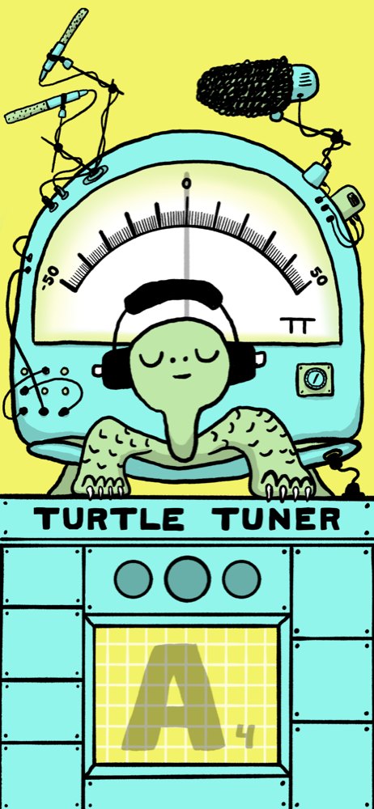

# Turtle Tuner

[](https://github.com/tsargent/turtle-tuner/actions/workflows/ci.yml)

A guitar tuner for iOS, built with Expo and React Native. A turtle in headphones listens through the microphone and watches the meter. It looks left or right when you're flat or sharp, perks up when you're close, cheers when you're in tune, and dozes off when the room goes quiet.



## How it works

- **Listening:** the microphone streams through `expo-audio`, and [YIN](src/tuner/detectPitch.ts) pitch detection runs at about 24 kHz every 60 ms. A note only counts once it holds steady for about 250 ms, so coughs and clicks don't wake the turtle.
- **Display:** the note (spelled C♯ E♭ F♯ G♯ B♭), the needle (±50 cents) and the lights show the current reading. The last note stays on the display after the sound stops, then dims after 10 s of silence.
- **Artwork:** the screen is stacked transparent PNG layers from the Figma design, positioned with [`assets/tuner/manifest.json`](assets/tuner/manifest.json).
- **Dark mode:** follows the system setting. The room goes dark while the meter and display stay lit.
- **Screen:** stays on while you're tuning, and lets the phone lock after 2 minutes with no note heard.

## Getting started

You'll need Node 22 and, for the simulator, Xcode.

```bash
npm install
npm run ios
```

The app runs in Expo Go. To try it without a guitar, use the simulated plucked string:

```bash
EXPO_PUBLIC_SIMULATE_PITCH=1 npx expo start
```

## Scripts

| Command | What it does |
| --- | --- |
| `npm start` | Start the dev server |
| `npm run ios` | Start and open the iOS simulator |
| `npm test` | Run the Jest tests (`npm run test:watch` to rerun on change) |
| `npm run lint` | ESLint |
| `npm run typecheck` | TypeScript |

## Project layout

```
src/app/          Routes (Expo Router); the tuner is index.tsx
src/components/   TunerFace: draws the layered artwork, needle and turtle
src/tuner/        Pitch detection, note naming, mic and display hooks
assets/tuner/     Artwork layers, their positions, and night versions
scripts/          Generates the prototype dark-mode layers
```

## Contributing

- Commit messages follow [Conventional Commits](https://www.conventionalcommits.org) (`feat:`, `fix:`, `test:` …), checked by commitlint.
- The pre-commit hook runs lint, typecheck and tests, and [CI](.github/workflows/ci.yml) runs them again on every push and pull request.
- Tests go in `__tests__/` folders next to the code they cover, never under `src/app/`, where every file is a route.

## Releases

Builds go to TestFlight through EAS:

```bash
npx eas-cli@latest build --platform ios --profile production --auto-submit
```

JavaScript and asset changes can ship as an over-the-air update, with no new build or review:

```bash
npx eas-cli@latest update --channel production --environment production --message "…"
```

Changes to native code or `app.json` need a new build. Phones pick up an update after two relaunches.
